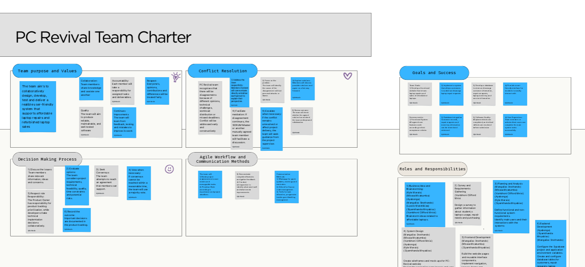
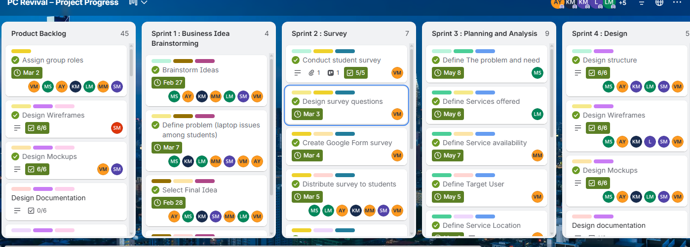
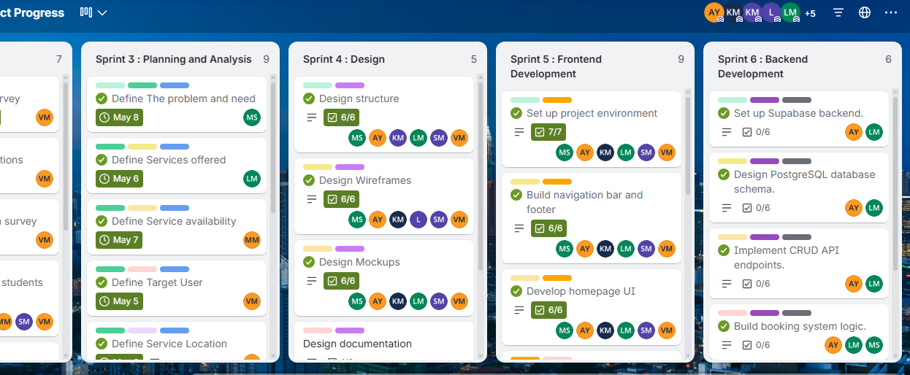

# Agile Portfolio: PC Revival

**Entrepreneurial WIL Project** | An affordable laptop repair and refurbished laptop sales platform for students.

**My roles:** Documentation (with AY) and Backend development (with AY)
**Team tools:** Trello, GitHub, WhatsApp
**Delivery:** 6 sprints
**Trello board:** [PC Revival: Project Progress](https://trello.com/b/68sMqKP5/pc-revival-project-progress)
**Live site:** [PC Revival website](https://pc-revival-fj68h8xcn-gee-c9e0.vercel.app/)

 <a href="#charter">1. Charter</a><a href="#stories">2. User Stories</a><a href="#product">3. Product Backlog</a><a href="#sprint">4. Sprint Backlog</a><a href="#logbook">5. Logbook</a><a href="#journey">My Journey</a> 

[Back to home](index)

---

## 1. Agile Team Charter

### Evidence

The Agile Team Charter was our team's shared agreement for PC Revival, written in Google Docs and last updated on 4 May 2026. Its main parts:

- **Purpose and vision:** an affordable, trustworthy on-campus laptop repair, upgrade and refurbished laptop service for CPUT students.
- **Roles (7 members):** Project Manager, Researcher, Writer/Editor, Presenter, Designer, Researcher Assistant and Designer Assistant. My role was **Researcher**.
- **Ways of working:** a Kanban board on Trello, with planning meetings, 2 to 3 stand-ups a week, reviews and retrospectives after milestones.
- **Success and goals:** SMART goals, including collecting 20 to 30 valid survey responses to support the problem statement.
- **Decisions:** consensus first, with the Project Manager deciding when the team is stuck.
- **Definition of Done:** work is complete, reviewed, evidenced (graphs or screenshots), documented and agreed by the team.
- **Values and risks:** transparency, shared ownership, respect and a learning mindset; risks such as data backup, security and building trust with students.

- My contribution: I contributed directly to setting our team success metrics, defining our survey research deliverables, and documenting the core technical roles and backend responsibilities for our service platform.
- Related card on Trello: *Assign group roles* (Product Backlog list, due 2 Mar), a whole-team card.

### Reflection 
*Note on method: All my reflections in this portfolio follow Gibbs' Reflective Cycle (Gibbs, 1988): Description, Feelings, Evaluation, Analysis, Conclusion and Action plan. I chose it because it is a widely used framework in higher education and its structure moves me from describing what happened to deciding what I will do differently.I feel its the most evidence based reflective framework*

**Description.** The charter was our written team guide that defined PC Revival, our campus laptop repair and refurbished tech project for CPUT students. We built it together using Google Docs and a Trello sprint board to agree on roles, rules, and our Definition of Done. Everyone took clear ownership of specific areas, and I was assigned to research and backend development tasks like database design.

**Feelings.** Agreeing on rules with a group of seven was uncomfortable for me at first because I am quiet and prefer keeping my head down and coding. I used to look at software purely as code, not seeing the real business or entrepreneurial point behind what we were building. As we talked through our goals, I started to feel less nervous and more curious about how technical work can solve real student needs and create business value.

**Evaluation.** Using Trello to break our work into visual sprint cards worked very well for our daily tasks. We genuinely followed our rules by designing the survey, setting up the UI, and working on the backend on Supabase and PostgreSQL. What did not work as well was keeping up with every meeting and review, especially when heavy technical work fell on just one or two of us.

**Analysis.** The charter made it easy for a quiet person like me to contribute without having to fight for attention in large discussions. Instead of who spoke the loudest, success was measured by finishing checklist items on Trello and meeting the Definition of Done. It also changed how I see software engineering entirely: I realised code is not just a school task, but a tool to build products and test business ideas. This gave me space to work in my own quiet style while steadily learning how to spot and use business opportunities in tech.

**Conclusion.** I learned that founders need clear written agreements so that quiet builders and vocal planners can work toward the same vision without friction. Good software engineering creates real growth only when it is tied directly to a clear business purpose.

**Action plan.** In my next team, I will share backend dependencies earlier on the board so technical work is better distributed from the start. I will also look at every technical feature through an entrepreneurial lens to make sure the software solves a genuine customer problem.

---

## 2. User Stories and Tasks

### Evidence

User stories were broken into tasks on Trello. My stories and tasks:

| Story | Tasks I worked on |
|-------|-------------------|
| As a student, I want to see the services offered, so that I know what help is available. | Define Services offered (Sprint 3, due 6 May), **assigned to me** |
| As a student, I want to book a repair online, so that I do not have to visit in person first. | Build booking system logic (Sprint 6), with Ayabonga and Sinothando |
| As an admin, I want to manage requests and data securely, so that I can run the business. | Set up Supabase backend; Design PostgreSQL database schema; Implement CRUD API endpoints (Sprint 6), with Ayabonga 

### Reflection

**Description.** We turned features into user stories by identifying who would use each part of PC Revival, whether a student needing laptop help or an admin managing repairs. From there, we phrased their needs using the standard "As a... I want to... so that..." format and broke each story down into manageable Trello cards and checklists. For example, the student repair and admin security needs were divided into distinct backend tasks like setting up Supabase, designing the database schema, and building CRUD APIs.

**Feelings.** Writing from the user's point of view felt quite strange and unnatural at first because my default mindset was to jump straight into database tables and code structures. As someone who likes working quietly behind the scenes, I was used to thinking about technical implementation rather than human emotions or pain points. Over time, shifting focus to what a stressed student actually experiences when their laptop breaks made the process feel meaningful instead of just theoretical.

**Evaluation.** The story about seeing available services was very clear and easy to split into direct tasks like listing repair types and prices on our Trello board. In contrast, the admin story around managing requests and securing data was much harder to divide because it touched so many backend layers, including authentication, schema design, and API logic. That technical complexity made it tempting to create overly broad development cards rather than user-focused micro-tasks.

**Analysis.** The struggle to break down technical tasks happened because I was initially thinking as a backend developer rather than an entrepreneur serving a customer. In software engineering, it is easy to obsess over database schemas and API endpoints without asking if they directly solve the user's immediate frustration. Connecting each technical card back to a real student need helped me realise that solid backend architecture is only valuable when it keeps user data safe and ensures a booking goes through smoothly. This shift in mindset showed me how technical skills must directly support commercial and customer value.

**Conclusion.** User stories taught me that customers do not pay for complex code or clean architectures; they pay to have a painful problem solved reliably and conveniently. As a builder, aligning technical work with user outcomes is what separates a school project from a viable product.

**Action plan.** Next time, I will slice large backend stories into smaller, testable vertical tasks based on user outcomes rather than purely technical layers. I will also validate the customer problem through quick research before writing a single database line to ensure every card builds real value.

---

## 3. Product Backlog

### Evidence

The Product Backlog list on our Trello board holds all 45 cards of project work for the whole team, grouped by phase (strategy, design, frontend, backend, testing, deployment, later improvements).

- Backlog items I was involved in: Assign group roles; Brainstorm Ideas; Define problem; Select Final Idea; Design structure; Design Mockups; Design Documentation.

### Reflection

**Description.** Our product backlog held all 45 cards covering every phase of PC Revival, from early strategy and role assignments to UI design, database setup, and post-launch ideas. It was organized by project stages and sprint dependencies, moving from initial concept validation into frontend screens and backend services. This structure let the team pull urgent work into active sprint lists while parking future enhancements for later.

**Feelings.** Seeing 45 cards lined up on the board was intimidating at first, especially as someone who feels most comfortable tackling one quiet, focused coding task at a time. It was frustrating to see features we were excited about get pushed into later improvements because my instinct was to build everything right away. Over time, accepting that a product must launch in stages gave me relief and helped me appreciate keeping scope manageable.

**Evaluation.** The backlog did an excellent job of visualizing our entire scope and clearly assigning owners using member tags. However, it lacked a clear ranking system within individual stages, making it hard to see which backlog items were non-negotiable versus optional. Without visible tags like "Must Have" or "Nice to Have," we sometimes debated what should be prioritized next.

**Analysis.** Deciding what to leave out was essential because a young business has limited time and resources and cannot afford to build features customers haven't asked for. I used to think good engineering meant writing as much software as possible, but entrepreneurship requires delivering value fast with the smallest practical scope. Keeping extra features in the backlog protected us from scope creep and kept our attention on the primary user journey: viewing repair services and submitting a booking. Leaving non-core tasks aside was not cutting corners, but making a deliberate commercial decision to deliver on time.

**Conclusion.** Prioritizing for customers taught me that shipping a simple, reliable solution to an immediate problem is better than having dozens of half-finished features. In business, progress is measured by working solutions in users' hands rather than a crowded backlog of ideas.

**Action plan.** Next time, I will introduce clear MoSCoW prioritization tags directly into our backlog columns so everyone knows the core priorities at a glance. I will also schedule weekly backlog grooming sessions with the team to archive outdated cards and keep the board clean.

## 4. Sprint Backlog

### Evidence

The project was delivered in 6 sprints. These are the cards I was assigned to (my initials on Trello are **LM**).

| Sprint | Focus | My cards |
|--------|-------|----------|
| 1 | Business idea brainstorming | Brainstorm Ideas; Define problem; Select Final Idea (team cards) |
| 2 | Survey | Distribute survey to students (team card) |
| 3 | Planning and analysis | Define Services offered (individual card) |
| 4 | Design | Design structure; Design Mockups (team cards) |
| 5 | Frontend development | Set up project environment (7/7); Build navigation bar and footer (6/6); Develop homepage UI (6/6) |
| 6 | Backend development | Set up Supabase backend; Design PostgreSQL database schema; Implement CRUD API endpoints (all with AY); Build booking system logic (with AY and MS) |

**Status of Sprint 6:** At the time of the board screenshot, the checklists on these Sprint 6 cards showed 0/6 as tasks were still being configured. Currently, the PostgreSQL database schema and Supabase project setup are completed, while the live booking system logic and CRUD API connections are in progress and being finalized against our frontend.

### Reflection

**Description.** The six sprints divided our project into structured phases, starting with business ideation and student surveys, moving through wireframing and frontend UI, and finishing with backend logic. My assigned cards included foundational group planning, my individual task of defining services, and pairing on frontend builds and Sprint 6 backend architecture.

**Feelings.** Working on team cards felt safe because responsibility was shared across all members, but taking on individual and paired cards like "Define Services offered" and backend setup felt much more personal. When Sprint 6 arrived and the board showed 0/6 completed items, I felt stressed and worried that people would assume no progress had been made. However, realizing that complex architectural work often happens locally before checklists get ticked off helped me stay calm and focused.

**Evaluation.** Our early sprints went smoothly, and we successfully moved our UI work across the line with full checklist completion on the frontend cards. What stalled was Sprint 6, where database setup, table relationships, and Supabase integration took longer than anticipated. Concentrating technical backend tasks across just two of us created an execution bottleneck that delayed our checklist updates.

**Analysis.** The work carried over into Sprint 6 because backend tasks were treated as large, end-of-project hurdles rather than being built alongside frontend pieces from day one. The 0/6 checklists happened because we were actively working on local database configurations and troubleshooting Supabase connections without updating the Trello cards incrementally. This taught me an important entrepreneurial lesson: when technical dependencies are grouped at the very end, any delay directly threatens product delivery. If we had built small, end-to-end vertical slices earlier, our progress would have been visible much sooner.

**Conclusion.** I learned that delivering in small, continuous steps prevents high-stress bottlenecks and gives early proof that a system actually works. Incremental development keeps a startup agile because it avoids the panic of a massive last-minute push.

**Action plan.** Next time, I will connect backend endpoints to basic UI screens during early sprints rather than saving all backend logic for the final sprint. I will also make it a daily rule to check off subtasks on Trello immediately so our board always reflects true progress.

## 5. Agile Logbook

### Evidence

#### Sprint 3: Planning and analysis
- **Completed:** Researched and compiled the list of core repair services (screen replacements, diagnostic checks, software reinstalls) and hardware upgrade options (RAM and SSD upgrades) with student-friendly price points for the "Define Services offered" card.
- **Next:** Coordinate with the design team to ensure these service categories and descriptions are mapped accurately onto the wireframe cards.
- **Impediments:** Estimating accurate hardware replacement part costs without confirmed supplier quotes from local vendors.

#### Sprint 5: Frontend development
- **Completed:** Collaborated on setting up the project development environment (7/7 checklist), reviewed the global CSS layouts, built the responsive navigation bar and footer components (6/6), and contributed to testing the homepage hero UI (6/6).
- **Next:** Link the completed navigation bar and service cards directly to the dynamic shop and booking pages.
- **Impediments:** Minor styling conflicts when integrating Tailwind classes across different screen sizes on mobile devices.

#### Sprint 6: Backend development
- **Planned / in progress:** Created the Supabase project environment and drafted the relational PostgreSQL schema for users, service listings, and repair bookings; API routing and booking logic integration are currently in progress.
- **Next:** Connect the booking form state to the Supabase client and test end-to-end CRUD submissions.
- **Impediments:** Managing asynchronous state and foreign key constraints between guest student submissions and admin request tables without breaking existing frontend mockups.

### Reflection

**Description.** In the logbook, I recorded completed tasks, immediate next steps, and technical blockers at the end of key milestones throughout our sprints. I wrote these notes after working sessions to keep an honest record of my personal contributions and technical hurdles across both planning and development.

**Feelings.** Writing down impediments honestly felt uncomfortable at first because admitting technical roadblocks or delays felt like showing weakness. Over time, however, being transparent about challenges brought relief because it gave the team an accurate picture of what was actually holding up the backend. It turned blockers into team problem-solving opportunities rather than hidden stress.

**Evaluation.** Entries with specific technical details, such as defining pricing tiers or configuring Supabase relationships, were very useful for tracking genuine progress. In contrast, some of the broader entries about general UI testing felt a bit thin and lacked detail on specific bug fixes. The stronger entries clearly guided our next working sessions much more effectively.

**Analysis.** Looking across the logbook, the recurring impediments were driven by external dependencies, supplier uncertainty, and late technical integration. They happened because technical work was often planned in isolation before considering how external data or UI state would connect into it. In software entrepreneurship, technical blockers directly stall business milestones, which proves why technical issues must be raised immediately rather than solved in secret. A visible logbook prevents small delays from quietly turning into project failures.

**Conclusion.** The logbook taught me that team accountability is not about pretending everything is on schedule, but about giving teammates honest visibility into where things truly stand. Real accountability allows a startup team to adapt quickly when unexpected obstacles arise.

**Action plan.** In future projects, I will log my progress and blockers daily in short bullet points right as they happen instead of waiting until the end of a sprint. I will also tag my teammates on specific blockers right away so we can resolve dependencies together without losing momentum.

---

## My Journey: Entrepreneurship and Software Engineering

When I first started studying software development, I viewed it strictly through technical mechanics: writing clean code, passing unit tests, and building database tables. I had little interest in business or entrepreneurship, assuming commercial planning was a distraction from actual engineering.

Working on PC Revival changed that mindset completely. The shift happened while I was working on the "Define Services offered" card and planning our backend repair booking logic. Looking at our student survey data, I realized students were not visiting tech shops because they feared high prices and long repair delays. It suddenly clicked that writing a database query in PostgreSQL or setting up Supabase authentication only mattered if it solved that real student anxiety. Code on its own has no value until it helps a student get their laptop working for class tomorrow.

As someone who naturally works quietly, I used to think entrepreneurship belonged only to loud salespeople and pitch presenters. PC Revival taught me that quiet builders create the foundation of a business by turning customer problems into dependable, scalable software products. Moving forward, I want to keep using this entrepreneurial lens, building software not just for the sake of code, but to build viable products that create genuine, practical impact.
