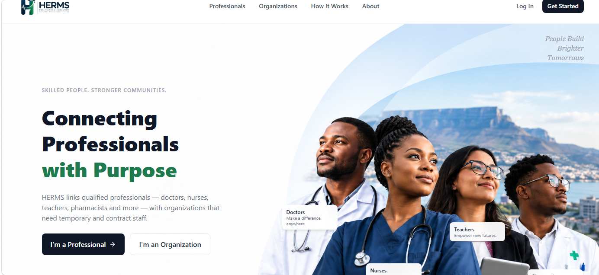
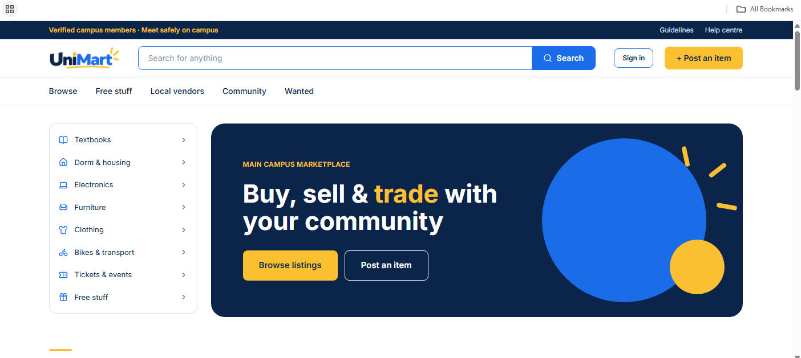
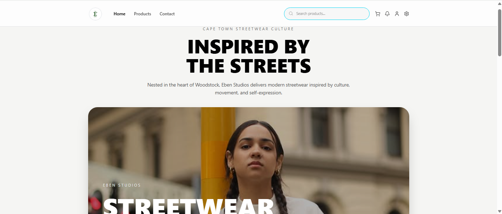

# Projects

A summary of the software projects I have worked on during my Diploma in ICT (Applications Development). Each one lists what it is, my role and the technology used.

[Back to home](index) · [Agile Portfolio: PC Revival](agile)

---

## Project Portfolio {#projects}

### HERMS: Healthcare and Education Resource Management System
Individual Applications Development Practice

**What it is:** A booking system for organisations such as hospitals and schools to book nurses and teachers respectively.

**My role:** Design the Organisational POJO and all related design pattern distribution

**Tech:** Java (with design patterns), React, Tailwind CSS

**Status:** Runs locally. Source code on GitHub: https://github.com/Siyamthanda-Mnyabiso/herms

**Design patterns used:** Factory,Singleton,Creational,Behavioural,Structural

### UniMart: CPUT Community Marketplace
Group project Project Management

**What it is:** A campus marketplace where students, faculty, residents and local vendors can buy, sell and trade. It has verified campus members, browse and free-stuff pages, local vendor shops, a wanted board for requests, in-app messaging, suggested safe pickup spots and campus events.

**My role:** Business Requirements and Supabase design

**Tech:** Node.js, and React + Vite., Supabase, Vercel

**Live site:** [unimart-mu.vercel.app](https://unimart-mu.vercel.app/)

### Eben Studios: Clothing E-commerce Store
Group project

**What it is:** An online store for a clothing business that had no online presence for trading, so customers can browse and buy its products on the web.

**My role:** Design database Supabase

**Tech:** Supabase React, Vercel

**Live site:** [eben-studios.vercel.app](https://eben-studios.vercel.app/)

### PC Revival: Student Laptop Repair and Refurbished Laptop Platform
Group project Entrepreneurial WIL

**What it is:** An affordable laptop repair, upgrade and refurbished laptop service for CPUT students, delivered in six Agile sprints.

**My role:** Researcher in the team charter, plus backend development (Supabase, PostgreSQL schema, API and booking logic) with a teammate.

**Tech:** Supabase, PostgreSQL, Tailwind CSS, Trello for Kanban

**Live site:** [PC Revival](https://pc-revival-fj68h8xcn-gee-c9e0.vercel.app/) · **Agile evidence:** [Agile Portfolio](agile)

### Student Residence Application
Group project CPUT

**What it is:** A Java application using Swing GUI components and pattern matching validation. It provides secure user registration, residence search, accommodation browsing with details, and housing application management with database persistence.

**My role:** Database design and Registration page design

**Tech:** Java, Swing, database persistence

